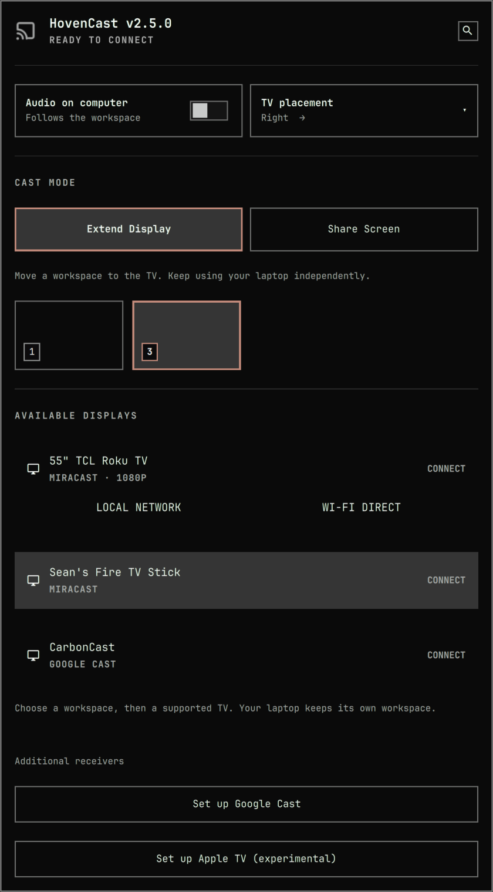
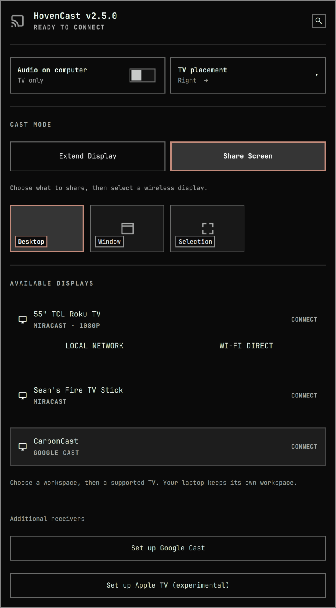

# HovenCast 2.5

**Your TV. A second Omarchy monitor.**

Move a workspace onto your TV while your laptop stays independently usable.
You can also share a screen, application window, or selected area with audio.
HovenCast runs as an Omarchy bar widget and streams directly over your local
network or a dedicated Wi-Fi Direct link.

## Receiver compatibility

| Receiver | Connection | Validation |
| --- | --- | --- |
| TCL Roku 32S331, 55S405, 65S451 | Miracast over Infrastructure, same LAN | Hardware tested |
| Fire TV Stick | Miracast over Wi-Fi Direct; keep Display Mirroring open | Hardware tested, cursor and audio tuned |
| Google Chromecast | Native Google Cast mirroring, same LAN | Hardware tested on CarbonCast; smooth cursor, picture and audio confirmed |
| Paired Apple TV | Encrypted native AirPlay mirroring, same LAN | Hardware tested; model-specific audio compatibility included |
| Other Roku, Miracast, Cast, or AirPlay receivers | Depends on receiver and Wi-Fi adapter | Compatibility candidates; not universally verified |

The tuned Google Cast default is 720p30 with a 6 Mbps maximum media bitrate.
Its 400 ms receiver playback target is not total cursor latency. A camera test
measured about 0.56 seconds using the same timing logic at a diagnostic lower
bitrate; final picture, playback, cursor and audio were confirmed at 6 Mbps.
See [casting measurements](docs/google-cast-cursor-results.md) and
[Fire Stick results](docs/firestick-cursor-results.md).

## Install and first use

On a current Omarchy Quattro/Hyprland desktop:

```sh
omarchy plugin add https://github.com/lockinflow-sudo/hovencast.git --enable
```

1. Open the HovenCast bar widget and choose **Review and set up**.
2. Review and confirm the changes in the terminal. Setup installs only missing
   Arch packages, builds the Miracast helper, installs the bundled native Cast
   and AirPlay helpers, and requests administrative approval for scoped Wi-Fi
   Direct and read-only receiver-metadata helpers.
3. Setup backs up your portal configuration, changes the system-wide
   screen-sharing picker, and restarts the user portal services. Finish other
   screen shares first. If portal setup fails, it restores the previous settings.
4. For Google Cast or Apple TV, use **Set up Google Cast** or **Set up Apple TV**
   in the panel. These install pinned optional Python dependencies and create
   receiver-specific firewall allowances when UFW is active. The receiver must
   be available on the network. Apple TV pairing happens through the panel PIN flow.
5. Choose a workspace and TV. Approve any receiver prompt. Your laptop keeps
   its own workspace while the selected workspace appears on the TV.

After updating an existing installation, stop casting and run `omarchy restart shell`
once so the running bar loads the new panel and version.

The install command adds the widget; it does not silently install packages or
change screen-sharing configuration. You can decline setup and return later.
Setup checks are read-only. A manual terminal entry point is also available:

```sh
~/.config/omarchy/plugins/hoven.cast/hovencast-setup
```

The panel's setup terminal stays open until you press Enter. If setup fails,
its output is saved privately in
`${XDG_STATE_HOME:-~/.local/state}/hovencast/last-setup-terminal.log`.
Keyboard input is not recorded.

For a known Chromecast that mDNS does not find:

```sh
~/.config/omarchy/plugins/hoven.cast/hovencast-chromecast-setup --host DEVICE_IP
```

The marketplace may still show **Manual setup** until its maintainers approve
the updated listing and remove the existing installation override. GitHub
publication alone does not change that marketplace setting.

## Requirements and setup changes

HovenCast targets Omarchy Quattro, Hyprland, PipeWire/Pulse, and the Hyprland
screen-sharing portal. Its core package checks cover Avahi, NetworkManager,
libnm, wpa_supplicant, dnsmasq, polkit, iptables, Python/GObject, GStreamer and
its media plugins, FFmpeg, libportal, libpulse, opus, libvpx, GCC/pkgconf,
grim/slurp, jq, and both desktop portal packages. The complete package list is
in [`scripts/setup.py`](scripts/setup.py). Existing packages are preserved.

Google Cast setup installs `PyChromecast==14.0.10`; Apple TV setup installs
`pyatv==0.18.0` in a user-owned virtual environment. Native helper source,
licenses, checksums and rebuild instructions are under [`native/`](native/).
The bundled helpers target Linux x86-64. The Google Cast binary depends on the
tested Arch FFmpeg/libvpx ABI; setup reports missing libraries before replacing
an existing helper. Other architectures or later ABI changes require a rebuild.

Wi-Fi Direct requires a compatible adapter and driver. Setup installs scoped
root-owned helpers, not unrestricted sudo access. Normal discovery and casting
use the active local session's limited polkit authorization. Wi-Fi profiles and
session firewall leases are removed on disconnect. Google Cast and AirPlay
setup record only newly created, receiver-specific UFW rules for later cleanup.

Some adapters require an explicit scan-MAC compatibility setting. It is **off by
default**. Use this only after diagnosing that adapter's negotiation failure:

```sh
~/.config/omarchy/plugins/hoven.cast/hovencast-setup --wifi-compat-adapter INTERFACE
```

This disables scan MAC randomization for that adapter, including ordinary Wi-Fi
scans. The installer explains the privacy tradeoff. Uninstall removes only an
unchanged HovenCast-owned compatibility file.

## Use and stop

**Extend Display** places a workspace on a dedicated wireless display. Choose
left, right, above, or below placement relative to your laptop. The panel can switch the TV's
workspace during a session. Moving an application between laptop and TV
workspaces also follows its audio where the application exposes a distinct
playback stream; one browser process spanning both displays can share audio.

**Share Screen** offers screen, window, and area selection. Window mode captures
the selected monitor locally and crops the outgoing stream to the chosen window.
Other monitor content is processed locally even though only the crop is sent.

Right-click the bar icon or use the panel Stop control. HovenCast restores the
workspace placement and prior audio route. Fire TV receivers may need Display
Mirroring reopened before a new connection. Names alone never merge receivers;
verified grouping keeps explicit Local network and Wi-Fi Direct choices.

## Remove and recover

Stop casting, disable the widget, then run cleanup **before** removing the plugin:

```sh
~/.config/omarchy/plugins/hoven.cast/hovencast-uninstall
omarchy plugin remove hoven.cast
```

Cleanup removes HovenCast-owned receiver firewall rules and scoped privileged
helpers, restores only portal values still owned by HovenCast, and restarts the
user portals. It preserves unrelated configuration and pre-existing firewall
rules. Installed packages, native helper files, optional Python environments,
and saved pairing data are retained rather than removing shared dependencies
or credentials automatically.

If the plugin was deleted before cleanup, the self-contained portal recovery
script remains at `${XDG_STATE_HOME:-$HOME/.local/state}/hovencast/restore-portal.py`:

```sh
python "${XDG_STATE_HOME:-$HOME/.local/state}/hovencast/restore-portal.py" remove
systemctl --user restart xdg-desktop-portal-hyprland.service xdg-desktop-portal.service
```

That recovery restores the picker only. Reinstall the same plugin version and
run its uninstaller to remove receiver firewall rules and privileged helpers.

## Privacy, validation and limitations

No cloud relay or saved screen recording is required. Session logs and picker
previews use user-only runtime storage. AirPlay pairing credentials are stored
with user-only permissions. Receiver names and LAN addresses are compatibility
signals; Miracast's IP checks are not cryptographic authentication. Native Cast
retains certificate verification, and native AirPlay uses paired encryption.
See [SECURITY.md](SECURITY.md) for the helper authorization and trust model.

The backend hardware tests were performed on an already configured laptop.
The isolated first-run tests exercise clone, terminal setup, cancellation,
failures, rollback and removal while simulating package installation,
privileged installation and desktop services. They do not establish a clean
machine's hardware compatibility. The [2.5 release checklist](RELEASE_CHECKLIST.md)
tracks the remaining acceptance gates.

Report receiver model, transport, Omarchy version and the observed failure using
[the compatibility form](https://github.com/lockinflow-sudo/hovencast/issues/new?template=compatibility-report.yml).
Do not include pairing secrets or unredacted personal screen content.

## Screenshots

| Extend Display | Share Screen |
| --- | --- |
|  |  |

The current screenshots show the earlier panel. A real laptop-and-TV demo is
planned; no workflow illustration is included.

## License

HovenCast's plugin code is MIT licensed. The separately invoked AirPlay helper
is LGPL-3.0-or-later with corresponding source included. Open Screen and its
bundled dependency notices accompany the native Google Cast helper. System
media libraries retain their own licenses.
